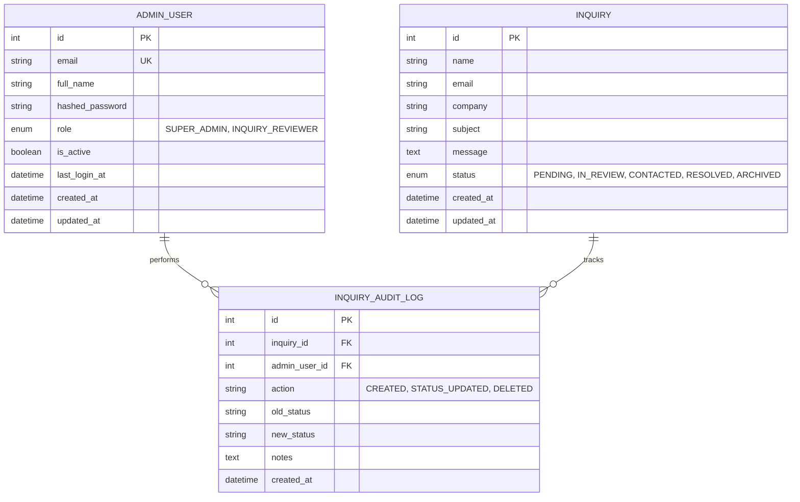
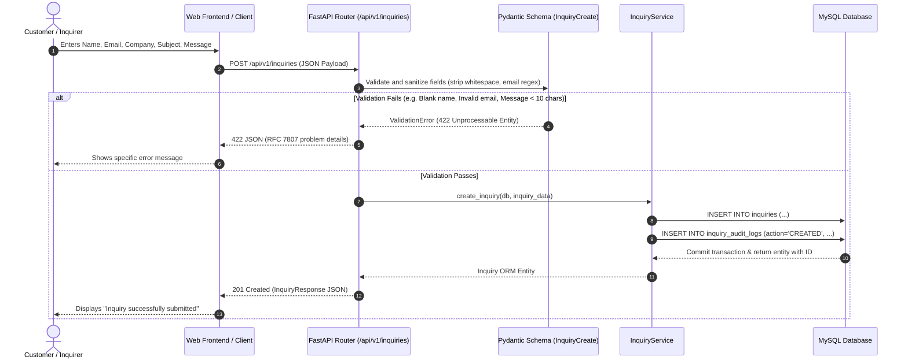
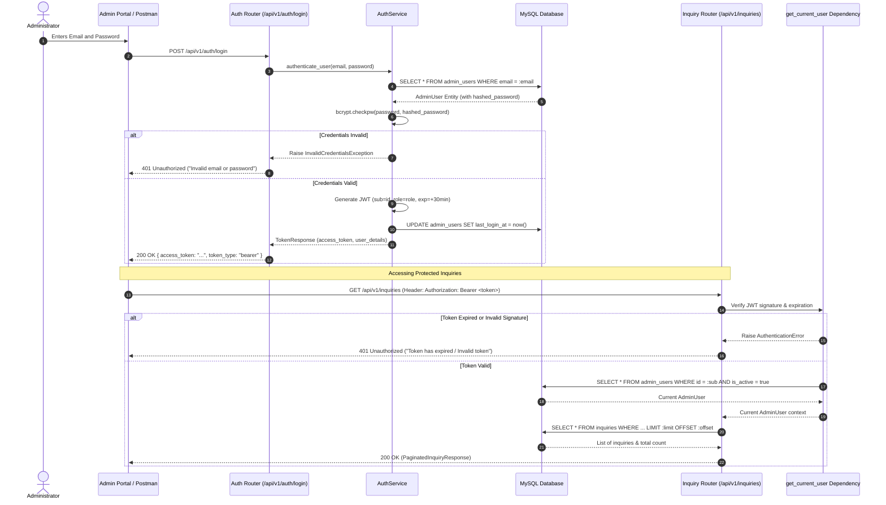

# Cynbit Technologies — Standalone Reference Backend Architecture

---

**Project**: Cynbit Technologies Backend Assessment — Secure Inquiry Management API  
**Architect & Developer**: Chahat Modi (Final-Year B.Tech CSE, JECRC University, Jaipur)  
**Technology Stack**: Python 3.11, FastAPI, Pydantic v2, SQLAlchemy 2.x, Alembic, MySQL 8.0+ / SQLite, PyJWT, Bcrypt, Pytest, HTTPX  
**Document Version**: 1.0 (Phase 3 Architectural Specification)  

---

## 1. Architectural Philosophy & Objectives

The standalone reference backend demonstrates how the findings identified during the Cynbit Technologies website audit (FIND-001 through FIND-010) are resolved in a production-grade, enterprise-ready system:

1. **Decoupled RESTful Architecture**: Eliminates the tight coupling of Next.js Server Actions by providing a standardized, stateless REST API documented via OpenAPI / Swagger.
2. **Individual Identity & RBAC**: Directly eliminates the single-password "Security Key" risk (FIND-001) by establishing individual administrator accounts, bcrypt password hashing, signed JWT access tokens, and Role-Based Access Control (`SUPER_ADMIN` vs `INQUIRY_REVIEWER`).
3. **Defense-in-Depth Middleware**: Implements custom middleware that enforces the security headers missing from Cynbit's edge (FIND-004, FIND-005, FIND-006) and restricts CORS to authorized client origins (FIND-003).
4. **Server-Side Input Sanitization**: Replaces reliance on client-side HTML5 validation with strict Pydantic v2 schemas that enforce email format, whitespace stripping, and length bounds.
5. **Robust Relational Persistence**: Uses SQLAlchemy 2.x with type annotations, clean transaction lifecycle management, and version-controlled Alembic migrations.

---

## 2. Multi-Layer System Architecture

```mermaid
flowchart TD
    subgraph Client Layer
        Web[Web Browser / Next.js Frontend]
        Mobile[Mobile Application / Client]
        ThirdParty[External CRM / Webhook Service]
    end

    subgraph Edge & Security Middleware
        CORS[CORS Middleware - Whitelisted Origins]
        SecHeaders[Security Headers Middleware - CSP, XFO, XCTO]
        RateLimiter[Rate Limiting & Request Throttling]
    end

    subgraph API Presentation Layer - FastAPI
        RouterAuth[/api/v1/auth]
        RouterInquiry[/api/v1/inquiries]
        RouterHealth[/api/v1/health]
        SwaggerDocs[/docs - OpenAPI v3]
    end

    subgraph Dependency & Security Layer
        JWTAuth[OAuth2 Password Bearer & JWT Validator]
        RBACGuard[Role-Based Access Control Guard]
        DBSession[Database Session Dependency - get_db]
    end

    subgraph Service Business Logic Layer
        AuthService[AuthService - Login, Token Issuance, Password Hashing]
        InquiryService[InquiryService - Creation, Pagination, Status Lifecycle, Deletion]
    end

    subgraph Data Persistence Layer - SQLAlchemy 2.x
        Models[ORM Models: Inquiry, AdminUser, InquiryAuditLog]
        Alembic[Alembic Migration Engine]
        Engine[Engine Connection Pool - pool_pre_ping, pool_recycle]
    end

    subgraph Storage Layer
        MySQL[(MySQL 8.0+ Enterprise Database)]
        SQLite[(SQLite In-Memory / Hermetic Test DB)]
    end

    Client Layer --> Edge & Security Middleware
    Edge & Security Middleware --> API Presentation Layer - FastAPI
    API Presentation Layer - FastAPI --> Dependency & Security Layer
    Dependency & Security Layer --> Service Business Logic Layer
    Service Business Logic Layer --> Data Persistence Layer - SQLAlchemy 2.x
    Data Persistence Layer - SQLAlchemy 2.x --> Storage Layer
```

---

## 3. Database Schema & Entity-Relationship (ER) Design



### 3.1 Table Specifications

#### Table: `inquiries`
Stores customer and partner business inquiries submitted via public contact forms:
- `id`: `INTEGER`, Primary Key, Auto Increment.
- `name`: `VARCHAR(100)`, NOT NULL — Name of inquirer (2 to 100 characters).
- `email`: `VARCHAR(255)`, NOT NULL, INDEXED — Contact email address.
- `company`: `VARCHAR(100)`, NULLABLE — Organization or business name.
- `subject`: `VARCHAR(150)`, NOT NULL — Subject or area of interest (3 to 150 characters).
- `message`: `TEXT`, NOT NULL — Inquiry content (10 to 2000 characters).
- `status`: `ENUM('PENDING', 'IN_REVIEW', 'CONTACTED', 'RESOLVED', 'ARCHIVED')`, Default `'PENDING'`, INDEXED.
- `created_at`: `DATETIME(timezone=True)`, Server Default `UTC_TIMESTAMP`, INDEXED.
- `updated_at`: `DATETIME(timezone=True)`, Server Default `UTC_TIMESTAMP`, on update `UTC_TIMESTAMP`.

#### Table: `admin_users`
Stores authenticated administrative users with individual credentials and assigned roles:
- `id`: `INTEGER`, Primary Key, Auto Increment.
- `email`: `VARCHAR(255)`, NOT NULL, UNIQUE, INDEXED — Corporate email address.
- `full_name`: `VARCHAR(100)`, NOT NULL — Administrator display name.
- `hashed_password`: `VARCHAR(255)`, NOT NULL — Bcrypt hashed password (work factor $\ge 12$).
- `role`: `ENUM('SUPER_ADMIN', 'INQUIRY_REVIEWER')`, Default `'INQUIRY_REVIEWER'`.
- `is_active`: `BOOLEAN`, Default `TRUE` — Account status flag.
- `last_login_at`: `DATETIME(timezone=True)`, NULLABLE.
- `created_at`: `DATETIME(timezone=True)`, Server Default `UTC_TIMESTAMP`.
- `updated_at`: `DATETIME(timezone=True)`, Server Default `UTC_TIMESTAMP`.

#### Table: `inquiry_audit_logs`
Maintains non-repudiation and an immutable audit trail of actions taken by administrators:
- `id`: `INTEGER`, Primary Key, Auto Increment.
- `inquiry_id`: `INTEGER`, FOREIGN KEY -> `inquiries.id` (ON DELETE CASCADE), NULLABLE.
- `admin_user_id`: `INTEGER`, FOREIGN KEY -> `admin_users.id` (ON DELETE SET NULL), NULLABLE.
- `action`: `VARCHAR(50)`, NOT NULL — e.g., `'STATUS_UPDATED'`, `'DELETED'`, `'VIEWED'`.
- `old_status`: `VARCHAR(50)`, NULLABLE.
- `new_status`: `VARCHAR(50)`, NULLABLE.
- `notes`: `TEXT`, NULLABLE.
- `created_at`: `DATETIME(timezone=True)`, Server Default `UTC_TIMESTAMP`.

---

## 4. API Endpoint Contracts & Specifications

All API endpoints follow RESTful conventions, return structured JSON payloads, and utilize standard HTTP status codes:

### 4.1 Authentication Endpoints (`/api/v1/auth`)

| Method | Endpoint | Access | Request Body | Response Status | Response Body |
|---|---|---|---|---|---|
| `POST` | `/api/v1/auth/login` | Public | `LoginRequest` (email, password) | `200 OK` | `TokenResponse` (access_token, token_type, expires_in, user) |
| `GET` | `/api/v1/auth/me` | Protected (Any Admin) | None (Bearer Token) | `200 OK` | `AdminUserResponse` (id, email, full_name, role, is_active) |

### 4.2 Inquiry Endpoints (`/api/v1/inquiries`)

| Method | Endpoint | Access | Request Body / Query Params | Response Status | Description |
|---|---|---|---|---|---|
| `POST` | `/api/v1/inquiries` | Public | `InquiryCreate` (name, email, company, subject, message) | `201 Created` | Creates a new customer inquiry with server-side validation. |
| `GET` | `/api/v1/inquiries` | Protected (Any Admin) | `page=1, page_size=20, status=PENDING, search=text` | `200 OK` | Paginated listing of inquiries with filtering and search. |
| `GET` | `/api/v1/inquiries/{id}` | Protected (Any Admin) | Path `id: int` | `200 OK` / `404 Not Found` | Retrieves detailed inquiry record by ID. |
| `PATCH` | `/api/v1/inquiries/{id}/status` | Protected (Any Admin) | `InquiryStatusUpdate` (status, notes) | `200 OK` / `400 Bad Request` | Updates inquiry lifecycle status and records audit log. |
| `DELETE` | `/api/v1/inquiries/{id}` | Protected (`SUPER_ADMIN` only) | Path `id: int` | `200 OK` / `403 Forbidden` | Deletes an inquiry record (enforces RBAC). |

### 4.3 System Endpoints

| Method | Endpoint | Access | Response Status | Description |
|---|---|---|---|---|
| `GET` | `/api/v1/health` | Public | `200 OK` | Health check verifying API and database connection status. |
| `GET` | `/docs` | Public | `200 OK` | Interactive Swagger UI documentation. |
| `GET` | `/redoc` | Public | `200 OK` | ReDoc API contract reference. |

---

## 5. Security Architecture & Threat Mitigation

### 5.1 Threat Mitigation Matrix

| Audit Finding | Threat / Risk | Mitigating Architecture in Reference Backend |
|---|---|---|
| **FIND-001** (Shared Key) | Credential compromise, no non-repudiation | Individual Admin accounts; bcrypt password hashing ($\text{cost} \ge 12$); cryptographic JWT access tokens; RBAC checks. |
| **FIND-002** (LocalStorage) | Session token exposure via XSS | Tokens are signed with `HS256`, enforced with short 30-minute expiration (`exp`), and validated statelessly on every request. |
| **FIND-003** (Wildcard CORS) | Cross-origin reading of document data | `CORSMiddleware` configured with explicit origin allowlists (`https://cynbit.in`, `https://www.cynbit.in`, `http://localhost:3000`). |
| **FIND-004** (Missing CSP) | Execution of malicious scripts / XSS | Custom `SecurityHeadersMiddleware` injects strict `Content-Security-Policy`. |
| **FIND-005** (Clickjacking) | UI redressing / iframe overlay attacks | `SecurityHeadersMiddleware` emits `X-Frame-Options: DENY` and `frame-ancestors 'none'`. |
| **FIND-006** (MIME Sniffing) | Executable payload disguised as image | `SecurityHeadersMiddleware` emits `X-Content-Type-Options: nosniff`. |
| **FIND-007** (Banner Leak) | Framework fingerprinting | Strips `server` and `x-powered-by` headers; suppresses default framework banners. |
| **FIND-010** (Coupled Actions) | Opaque error handling, lack of API contract | Fully decoupled REST API with OpenAPI schema and structured RFC 7807 error responses. |

### 5.2 Security Headers Middleware Specification
Every HTTP response emitted by the application will include:
```http
Content-Security-Policy: default-src 'self'; frame-ancestors 'none';
X-Frame-Options: DENY
X-Content-Type-Options: nosniff
Referrer-Policy: strict-origin-when-cross-origin
Permissions-Policy: geolocation=(), camera=(), microphone=()
Strict-Transport-Security: max-age=63072000; includeSubDomains; preload
```

---

## 6. Project Directory Structure

```
cynbit-backend-assessment/
│
├── app/
│   ├── __init__.py
│   ├── main.py                     # FastAPI application factory & middleware stack
│   │
│   ├── core/
│   │   ├── __init__.py
│   │   ├── config.py               # Pydantic v2 BaseSettings (environment variables)
│   │   ├── security.py             # Bcrypt password hashing & JWT token operations
│   │   ├── middleware.py           # Custom SecurityHeadersMiddleware
│   │   └── exceptions.py           # Centralized exception handlers (RFC 7807 formatted)
│   │
│   ├── database/
│   │   ├── __init__.py
│   │   ├── base.py                 # SQLAlchemy DeclarativeBase
│   │   └── connection.py           # Engine creation, sessionmaker & get_db dependency
│   │
│   ├── models/
│   │   ├── __init__.py
│   │   ├── inquiry.py              # SQLAlchemy Inquiry & InquiryAuditLog models
│   │   └── admin.py                # SQLAlchemy AdminUser model
│   │
│   ├── schemas/
│   │   ├── __init__.py
│   │   ├── common.py               # Pagination & error schemas
│   │   ├── inquiry.py              # InquiryCreate, InquiryResponse, InquiryUpdate schemas
│   │   └── auth.py                 # LoginRequest, TokenResponse, AdminUserResponse schemas
│   │
│   ├── routers/
│   │   ├── __init__.py
│   │   ├── health.py               # Health check endpoint
│   │   ├── auth.py                 # Login & current user profile endpoints
│   │   └── inquiry.py              # Public submit & protected inquiry management endpoints
│   │
│   ├── services/
│   │   ├── __init__.py
│   │   ├── auth_service.py         # Authentication verification, hashing & tokens
│   │   └── inquiry_service.py      # Inquiry CRUD, pagination & audit log management
│   │
│   └── dependencies/
│       ├── __init__.py
│       └── auth.py                 # OAuth2Bearer, get_current_user & require_super_admin
│
├── alembic/
│   ├── versions/                   # Migration revision scripts
│   ├── env.py                      # Alembic environment with model metadata
│   └── script.py.mako              # Migration script template
│
├── tests/
│   ├── __init__.py
│   ├── conftest.py                 # Pytest fixtures, test database setup & client
│   ├── test_inquiries.py           # Public submission & protected inquiry CRUD tests
│   ├── test_auth.py                # Admin login, invalid credentials & JWT tests
│   ├── test_validation.py          # Field boundaries, invalid emails & sanitization tests
│   └── test_security.py            # RBAC tests, security headers & error format tests
│
├── docs/
│   ├── audit_scope_and_plan.md     # Audit methodology & scope
│   ├── evidence_register.md        # 18-point classified evidence register
│   ├── findings.md                 # 10-finding detailed technical register
│   ├── technical_audit_report.md   # Comprehensive 16-section technical report
│   ├── architecture.md             # This system architecture blueprint
│   ├── api_documentation.md        # Interactive endpoint documentation & payloads
│   ├── Cynbit_Backend_Technical_Audit_Report.docx # Editable Word document
│   └── Cynbit_Backend_Technical_Audit_Report.pdf  # 6-page shareable PDF
│
├── scripts/
│   ├── generate_docx_report.py     # Word report generator
│   ├── generate_pdf_report.py      # PDF report generator
│   └── seed_admin.py               # Database seeder for initial superadmin account
│
├── .env.example                    # Template environment variables
├── .gitignore                      # Git ignore rules (secrets, pycache, venv)
├── alembic.ini                     # Alembic migration configuration
├── requirements.txt                # Locked application dependencies
└── README.md                       # Comprehensive setup & project guide
```

---

## 7. Sequence Diagrams

### 7.1 Public Customer Inquiry Submission



### 7.2 Administrator Authentication & Protected Action Flow



