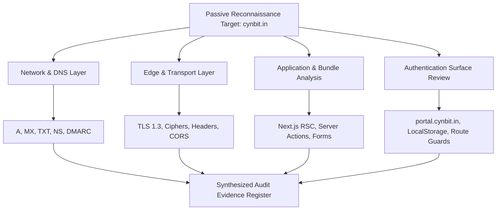
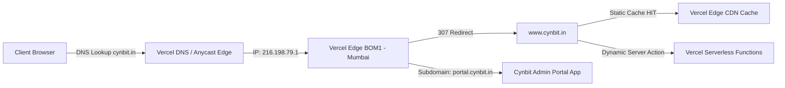
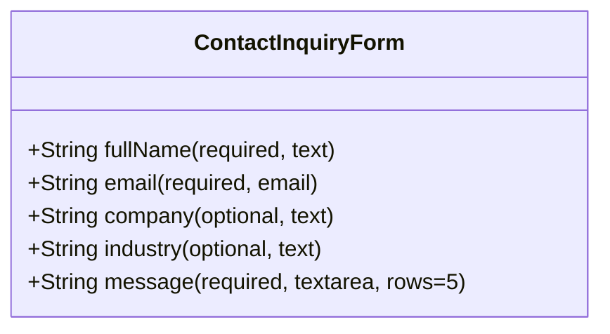
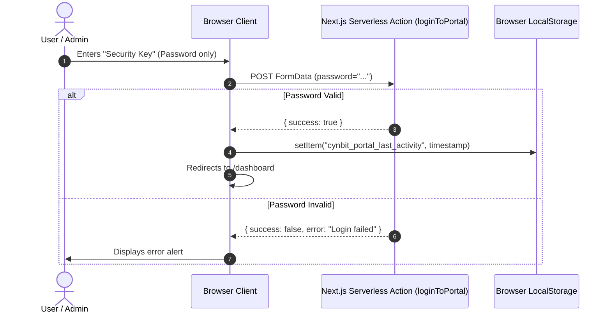
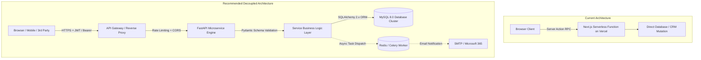
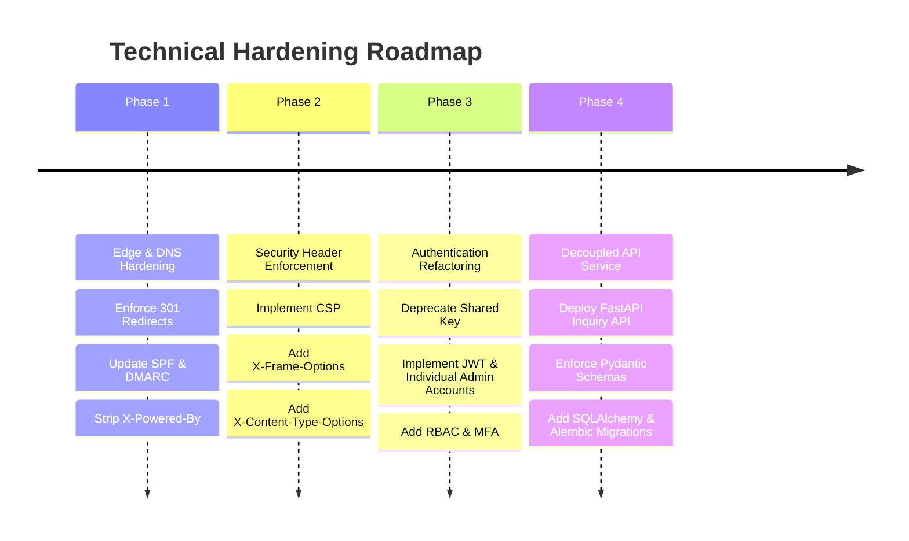

# Cynbit Technologies — Backend Technical Audit Report

---

**Document Control**
- **Document Title**: Backend Technical Audit Report & Architecture Review
- **Target Organization**: Cynbit Technologies (Jaipur, Rajasthan, India)
- **Target Systems**: `https://cynbit.in/` (Canonical: `https://www.cynbit.in/`), `https://portal.cynbit.in/`
- **Lead Technical Auditor**: Chahat Modi
- **Academic Affiliation**: Final-Year B.Tech Computer Science and Engineering, JECRC University, Jaipur
- **Assessment Scope**: Non-Intrusive, Passive Technical and Architectural Observation
- **Date of Assessment**: November 1, 2026
- **Document Version**: 1.0 (Final Submission)

---

## Table of Contents
1. [Executive Summary](#1-executive-summary)
2. [Assessment Scope and Methodology](#2-assessment-scope-and-methodology)
3. [Website Architecture — Publicly Observable View](#3-website-architecture--publicly-observable-view)
4. [API Behaviour and Structure](#4-api-behaviour-and-structure)
5. [Data Handling and Validation](#5-data-handling-and-validation)
6. [Authentication and Authorization](#6-authentication-and-authorization)
7. [Security Observations](#7-security-observations)
8. [Performance Observations](#8-performance-observations)
9. [Error Handling & Observability](#9-error-handling--observability)
10. [Potential Backend Architecture Improvements](#10-potential-backend-architecture-improvements)
11. [Recommended Technical Improvements](#11-recommended-technical-improvements)
12. [Reference Backend Architecture](#12-reference-backend-architecture)
13. [Limitations and Ethical Testing Statement](#13-limitations-and-ethical-testing-statement)
14. [Conclusion](#14-conclusion)
15. [References and Evidence Register](#15-references-and-evidence-register)

---

## 1. Executive Summary

Cynbit Technologies is an AI automation and custom software development enterprise based in Jaipur, Rajasthan, offering custom software solutions, autonomous AI agents, and corporate training. As part of the Cynbit Backend Developer Technical Assessment, a passive, non-intrusive backend technical audit of Cynbit’s web infrastructure was executed on November 1, 2026.

### Key Observations
1. **Edge Deployment & Modern Framework**: The frontend and application layer are deployed on the **Vercel Global Edge Network**, terminating in the **Mumbai (BOM1) Point of Presence**, delivering low latency for Indian visitors. The application utilizes the **Next.js App Router** with React Server Components (RSC) and Next.js Server Actions for client-server state transitions.
2. **Robust Transport Layer Cryptography**: The web platform enforces modern cryptographic standards, using **TLS 1.3** with AES-128-GCM cipher negotiation and an automated **Let’s Encrypt** SSL/TLS certificate. Strict Transport Security (`Strict-Transport-Security: max-age=63072000`) is enforced with a two-year preload directive.
3. **Authentication Model Considerations**: The internal portal at `https://portal.cynbit.in/` uses a **single-field "Security Key"** authentication mechanism with no individual user identification, no multi-factor authentication (MFA), and session timestamp persistence inside browser `localStorage`.
4. **Missing Defense-in-Depth HTTP Headers**: The web edge lacks critical browser security headers, including `Content-Security-Policy` (CSP), `X-Frame-Options` (Clickjacking defense), and `X-Content-Type-Options: nosniff`. Furthermore, `Access-Control-Allow-Origin: *` (wildcard CORS) is returned on HTML document responses.
5. **Coupled Mutation Architecture**: User inquiries (`/contact`) and job applications (`/careers`) are submitted via Next.js Server Actions rather than through a decoupled, independently testable RESTful API with published OpenAPI/Swagger contracts.

This report documents these findings in detail and provides an actionable reference architecture using **FastAPI**, **MySQL 8.0+**, **SQLAlchemy 2.x**, **Alembic**, and **JWT Authentication** to demonstrate industry-standard backend engineering practices.

---

## 2. Assessment Scope and Methodology

### 2.1 Testing Methodology
This assessment strictly adhered to passive, authorized, non-intrusive observation principles derived from the **OWASP Web Security Testing Guide (WSTG v4.2)**:



### 2.2 Evidence Classification Framework
To maintain technical accuracy and prevent unsubstantiated assumptions, all findings are categorized into four tiers:
- **[OBSERVED]**: Directly verified via network captures, HTTP responses, DNS records, or public JavaScript chunks.
- **[INFERRED]**: A logical, technical deduction based on visible architectural patterns.
- **[POTENTIAL RISK]**: A plausible engineering or security risk identified from observable configurations that would require internal review to confirm exploitability.
- **[NOT VERIFIABLE]**: An internal backend capability (e.g., ORM sanitization, database indexes, server-side queue workers) that cannot be confirmed from external observation alone.

---

## 3. Website Architecture — Publicly Observable View

### 3.1 Network and Edge Topology



- **Domain Resolution**: `cynbit.in` resolves to IP `216.198.79.1` (Vercel Anycast edge).
- **Canonicalization**: Requests to apex `cynbit.in` receive an HTTP `307 Temporary Redirect` pointing to `https://www.cynbit.in/`.
- **Portal Subdomain**: Dedicated portal available at `https://portal.cynbit.in/` (also redirected from `https://www.cynbit.in/portal`).
- **CDN Behavior**: Static assets and pre-rendered SSG pages return `X-Vercel-Cache: HIT`, with `Age` counters confirming edge cache warming.

---

## 4. API Behaviour and Structure

### 4.1 Absence of Traditional REST Endpoints
During passive inspection of network calls and public script bundles:
- Requests to `https://www.cynbit.in/api` and `https://portal.cynbit.in/api` return an HTTP `404 Not Found` page generated by Next.js.
- Rather than routing client interactions through traditional REST APIs (e.g. `POST /api/v1/inquiries`), the site relies on **Next.js Server Actions**.

### 4.2 Identified Server Actions

| Action Name | Cryptographic Reference ID | Origin Route | Purpose |
|---|---|---|---|
| `submitInquiry` | `40247ba4465344b3386595bab4303317cdcce907df` | `/contact` | Processes general inquiries and contact submissions. |
| `submitCandidateApplication` | `40645a00e04f6854903cf3a65fda4c75ddd7691de9` | `/careers/[slug]` | Processes multi-part job application data. |
| `loginToPortal` | `40d93da1cc26de4ef37bcb273184b7141ef77a50f8` | `portal.cynbit.in/` | Authenticates administrator into the internal portal. |

### 4.3 Technical Implications
- **Coupled Ecosystem**: Server Actions are tightly tied to Next.js client bundles and React hydration trees. While this reduces boilerplate for simple React apps, it prevents external services, third-party webhook integrations, or native mobile clients from accessing inquiry endpoints cleanly.
- **Contract Ambiguity**: In the absence of an OpenAPI / Swagger definition, API contract testing, payload contract verification, and automated client generation are absent.

---

## 5. Data Handling and Validation

### 5.1 Contact Inquiry Form Analysis
Inspection of `contact/page-a581c8d7462124d9.js` reveals the following input schema:



- **Client Validation**: Relies on basic HTML5 constraints (`required`, `type="email"`).
- **Missing Explicit Bounds**: No `maxLength` or `minLength` constraints are enforced on the client inputs for `fullName`, `company`, or `industry`.
- **Potential Risk**: If the underlying Next.js server action lacks strict backend schema validation (e.g., Zod or Pydantic validation), oversized inputs, empty whitespace strings, or malformed payloads could cause database buffer truncation or unhandled backend exceptions.

### 5.2 Career Application Form Analysis
Inspection of `careers/[slug]/page-082725dddd6cb4ac.js` reveals a more complex data schema:
- **Client Serialized JSON**: The form manages applicant education history in a React state array (`educationData`) and appends it to `FormData` as a JSON string:
  ```javascript
  let r = new FormData(e.currentTarget);
  r.append("jobId", t);
  r.append("educationData", JSON.stringify(y));
  ```
- **Duplicate Detection**: The client code handles responses with `s.isDuplicate && s.trackingUrl`, demonstrating that the backend maintains applicant deduplication logic and assigns tracking URLs to existing candidates.

---

## 6. Authentication and Authorization

### 6.1 Portal Authentication Mechanism
The administrative portal at `https://portal.cynbit.in/` was inspected:



### 6.2 Key Authentication Deficiencies
1. **Shared Single-Secret Model**: No username, email, or individual identity is captured. All administrative users utilize the same security key.
2. **Absence of Multi-Factor Authentication**: Single-factor password authentication without TOTP/SMS/WebAuthn.
3. **Session Activity in LocalStorage**: `localStorage.setItem("cynbit_portal_last_activity", Date.now().toString())` exposes session activity tracking to potential client-side script inspection.
4. **Route Guard Implementation**: Direct unauthenticated GET requests to `https://portal.cynbit.in/dashboard` return an HTTP `307 Temporary Redirect` back to `/`, confirming that server-side route guards are operational.

---

## 7. Security Observations

### 7.1 Security Headers Audit Matrix

| Security Header | Status on cynbit.in | Industry Standard Recommendation | Risk Level |
|---|---|---|---|
| `Strict-Transport-Security` | **Present** (`max-age=63072000`) | Enforce HTTPS for $\ge 1$ year with preload | **Compliant** |
| `Content-Security-Policy` | **Missing** | Restrict script, frame, and connect sources | **Medium** |
| `X-Frame-Options` | **Missing** | `DENY` or `SAMEORIGIN` to stop Clickjacking | **Medium** |
| `X-Content-Type-Options` | **Missing** | `nosniff` to prevent MIME-type confusion | **Low** |
| `Referrer-Policy` | **Missing** | `strict-origin-when-cross-origin` | **Low** |
| `Permissions-Policy` | **Missing** | Restrict geolocation, camera, microphone | **Low** |
| `Access-Control-Allow-Origin` | **Wildcard (`*`)** | Restrict strictly to trusted origins | **Medium** |

### 7.2 Information Exposure via Response Headers
Dynamic routes (such as `/dashboard`) return the following fingerprinting headers:
```http
X-Powered-By: Next.js
Server: Vercel
X-Matched-Path: /portal/dashboard
```
Exposing framework banners simplifies automated vulnerability scanning by attackers.

### 7.3 Email & Domain Security (DNS Audit)
- **MX Record**: `cynbit-in.mail.protection.outlook.com` (Microsoft 365).
- **SPF Record**: `v=spf1 include:secureserver.net -all` (Points to Secureserver/GoDaddy, omitting Microsoft 365).
- **DMARC Record**: `_dmarc.cynbit.in` -> `v=DMARC1; p=none;` (Unenforced monitoring policy).

---

## 8. Performance Observations

### 8.1 Publicly Observable Performance Strengths
1. **Edge Caching**: Pre-rendered SSG pages and static assets return `X-Vercel-Cache: HIT`, ensuring minimal response times from Vercel's Mumbai node.
2. **Modern Asset Delivery**: Web fonts are loaded via preloaded `.woff2` files (`rel="preload" as="font" crossorigin=""`), minimizing font layout shift.
3. **CSS Optimization**: Tailwind CSS styles are pre-compiled and chunked into optimized stylesheets (`ab1584e3d32cd2d2.css`).

### 8.2 Optimization Opportunities
1. **Canonical Redirection Efficiency**: `cynbit.in` issues a `307 Temporary Redirect` rather than a `301 Permanent Redirect`. Browsers will re-query the apex domain repeatedly instead of caching the redirect permanently.
2. **Third-Party Script Loading**: Google Tag Manager (`G-LK6CQWCWX0`) and Google Fonts are loaded synchronously in the document head.

---

## 9. Error Handling & Observability

### 9.1 Public Error Handling Behavior
- Unmapped routes (e.g., `/api`, `/non-existent-path`) return a clean, styled Next.js `404 Not Found` page (`X-Matched-Path: /404`).
- No internal stack traces, database query logs, or sensitive server paths are leaked in standard 404 responses.
- In client form bundles, error handling is implemented via generic user-friendly strings:
  ```javascript
  r.success ? i(!0) : n("Something went wrong. Please try again or email us directly.");
  ```
  While safe from information leakage, it lacks structured error codes for frontend debugging.

---

## 10. Potential Backend Architecture Improvements



### Key Architectural Shifts
1. **Decoupled API Tier**: Transition from RPC Server Actions to an independent RESTful microservice built with **FastAPI**.
2. **Explicit Data Contracts**: Define strict **Pydantic schemas** to validate and sanitize every payload before it reaches database operations.
3. **Enterprise Authentication**: Replace the single shared "Security Key" with **JWT access and refresh tokens**, individual user records, and role-based permissions (`Admin`, `Staff`, `Auditor`).
4. **Relational Integrity**: Store inquiries and audit trails in **MySQL 8.0+** using **SQLAlchemy 2.x** and version-controlled **Alembic migrations**.

---

## 11. Recommended Technical Improvements



1. **DNS & Mail Security**:
   - Update the SPF record: `v=spf1 include:spf.protection.outlook.com include:secureserver.net -all`.
   - Upgrade DMARC policy from `p=none` to `p=quarantine` or `p=reject`.
2. **HTTP Security Headers**:
   - Enforce `Content-Security-Policy`, `X-Frame-Options: DENY`, and `X-Content-Type-Options: nosniff`.
   - Remove wildcard CORS from top-level document responses.
3. **Identity & Access Management**:
   - Introduce individual administrator accounts with hashed passwords (`bcrypt` / `argon2id`).
   - Implement signed JWT access tokens with short TTLs and role claims.
4. **Decoupled API Implementation**:
   - Build a standalone FastAPI inquiry management service with automated Swagger documentation (`/docs`).

---

## 12. Reference Backend Architecture

To demonstrate how the recommended improvements can be implemented in production, a standalone reference backend has been architected:

```
cynbit-backend-assessment/
│
├── app/
│   ├── main.py                     # FastAPI application factory & middleware
│   ├── core/
│   │   ├── config.py               # Pydantic BaseSettings environment config
│   │   ├── security.py             # Password hashing (bcrypt) & JWT operations
│   │   └── exceptions.py           # Global exception handlers & structured responses
│   ├── database/
│   │   ├── connection.py           # SQLAlchemy session engine & lifecycle
│   │   └── base.py                 # Declarative Base for models
│   ├── models/
│   │   ├── inquiry.py              # SQLAlchemy Inquiry relational model
│   │   └── admin.py                # SQLAlchemy AdminUser relational model
│   ├── schemas/
│   │   ├── inquiry.py              # Pydantic schemas for Inquiry creation & responses
│   │   └── auth.py                 # Pydantic schemas for Login, Tokens & Users
│   ├── routers/
│   │   ├── inquiry.py              # Public create & Protected admin inquiry endpoints
│   │   └── auth.py                 # Admin login, token refresh & profile endpoints
│   ├── services/
│   │   ├── inquiry_service.py      # Business logic & repository transactions
│   │   └── auth_service.py         # Authentication verification & token issuance
│   └── dependencies/
│       └── auth.py                 # JWT bearer token verification & RBAC guard
│
├── alembic/                        # Database migration scripts & environment
├── tests/                          # Automated Pytest + HTTPX test suite
├── docs/                           # Audit reports, findings & API documentation
├── .env.example                    # Template environment variables
├── requirements.txt                # Locked application dependencies
└── README.md                       # Comprehensive setup & architecture guide
```

---

## 13. Limitations and Ethical Testing Statement

### 13.1 Ethical Testing Declaration
All testing conducted during this assessment was strictly **passive, external, and non-intrusive**:
- No administrative credentials were brute-forced or guessed.
- No form payloads were submitted to Cynbit’s production database or email handlers.
- No denial-of-service or stress-testing attacks were performed.
- All observations were collected from publicly available HTTP headers, DNS records, and unauthenticated static script bundles.

### 13.2 Testing Limitations
- **Internal Database Architecture**: The exact database engine, table structure, and indexing strategies utilized behind Cynbit’s Vercel serverless functions cannot be observed externally without authorized internal codebase access.
- **Serverless Worker Implementations**: Whether background task queues (e.g., Celery, BullMQ, QStash) are used for notification dispatch is unverified externally.

---

## 14. Conclusion

Cynbit Technologies’ web presence benefits from a high-performance Vercel Edge deployment in Mumbai, modern React Server Components, and robust TLS 1.3 transport security. However, observable opportunities exist to significantly harden the security posture and improve architectural scalability:
1. Upgrading administrative authentication from a single shared security key to individual user accounts with JWT and RBAC.
2. Configuring modern defense-in-depth HTTP security headers (CSP, XFO, XCTO).
3. Decoupling core business functions (such as inquiry and applicant management) into an independent, well-documented RESTful API service.

The standalone reference backend built in subsequent phases of this assessment directly realizes these recommendations.

---

## 15. References and Evidence Register

1. **OWASP Web Security Testing Guide (WSTG v4.2)**:
   - WSTG-INFO-02: Fingerprint Web Server
   - WSTG-CONF-07: HTTP Strict Transport Security
   - WSTG-ATHN-01: Credentials Transported over an Encrypted Channel
   - WSTG-SESS-02: Cookie Attributes Testing
2. **RFC 7519**: JSON Web Token (JWT) Standard.
3. **RFC 8446**: The Transport Layer Security (TLS) Protocol Version 1.3.
4. **Cynbit Technical Evidence Register**: Detailed in [`docs/evidence_register.md`](file:///c:/Users/Lenovo/Desktop/cynbit-backend-assesment/docs/evidence_register.md).
5. **Cynbit Findings Register**: Detailed in [`docs/findings.md`](file:///c:/Users/Lenovo/Desktop/cynbit-backend-assesment/docs/findings.md).

